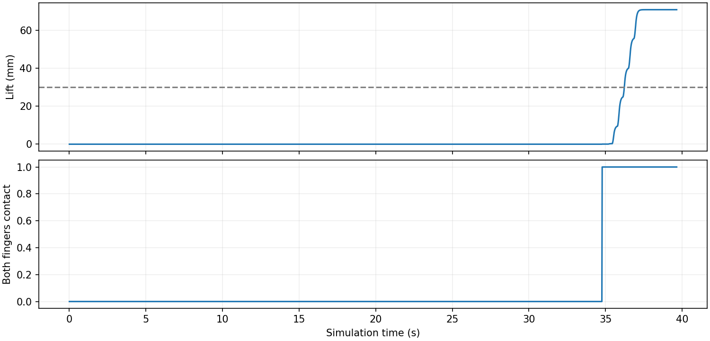
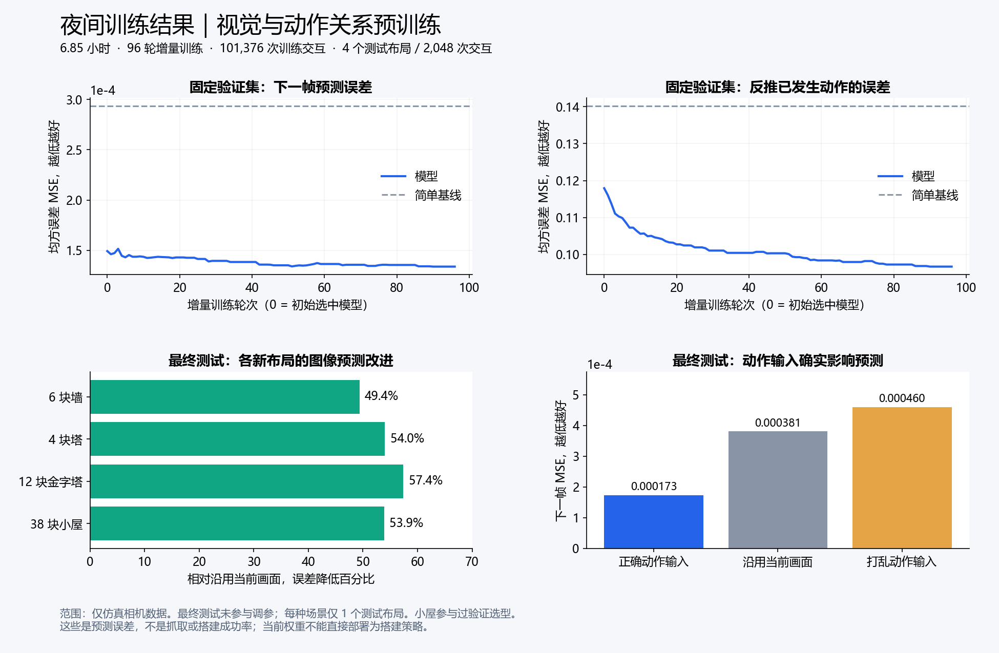

# 单相机机械臂：结果、分析与实验记录

本快照包含 BRICKLAB 说明书平台整合、夜间视觉/动作预训练，以及单块积木基础抓取基线。
**独立抓取测试为 3/5 成功；预训练误差下降不等于抓取成功；尚未完成说明书自动搭建或实机验收。**

## 阅读顺序

- [完整实验过程与失败分析](EXPERIMENT_LOG.md)
- [全部 32 条抓取实验记录（CSV）](run-ledger.csv) / [JSON](run-ledger.json)
- [独立测试原始汇总](evidence/camera_grasp/frozen-eval-v1/summary.json)
- [抓取图文报告](reports/grasp/index.html) / [看板截图](reports/grasp/dashboard.png)
- [夜间预训练图文报告](reports/pretraining/index.html) / [最终留出测试](evidence/camera_training/runs/20261111-010148/final-test.json)
- [完整原始数据、模型、日志、依赖资源与恢复方法](ARTIFACTS.md)
- [算法协议、启动与评价边界](../../CAMERA_ONLY.md) / [BRICKLAB 整合](../../BRICKLAB.md)
- [本次发布的六组软件回归检查](validation/release-checks.json) / [全量归档回读校验](artifacts/verification.json)

GitHub 可以直接阅读 Markdown、JSON 和 PNG。HTML 报告下载后可本地打开；仓库中的抓取报告已去掉仅适用于本机服务的实时轮询，录像和图表均使用相对路径。

## 1. 基础抓取：固定版本的独立测试

控制器自行实现无标定图像视觉伺服，**不是**把夜间预训练权重当作抓取策略。
动作流程是观察、方向对准、小幅主动探测、闭环接近、闭爪、反向执行自身接近指令、保持。
控制输入仅有一台腕部 RGB 摄像头，以及控制器自己发出的指令历史。没有深度、关节实测、相机外参、物体身份、物体位姿或仿真阶段输入。

评价器独立读取 PhysX 位置和指尖接触力，既不选择动作，也不触发策略重试。
成功要求**同一积木抬升至少 30 mm，且双指接触连续保持至少 2 秒**。
场景为单块直立 2×4 积木，随机平面位置、偏航和灰度材质。没有物体抓取焊接、吸附或初始化后的位姿写入。

| 新场景种子 | 结果 | 最大抬升 | 连续双指接触 | 终止情况 |
|---|---|---:|---:|---|
| [52001](evidence/camera_grasp/frozen-eval-v1/52001/result.json) | 成功 | 70.97 mm | 3.42 s | 控制流程完成 |
| [52002](evidence/camera_grasp/frozen-eval-v1/52002/result.json) | 失败 | 约 0 mm | 0 s | 初始图像未检出完整矩形积木 |
| [52003](evidence/camera_grasp/frozen-eval-v1/52003/result.json) | 成功 | 68.31 mm | 3.34 s | 控制流程完成 |
| [52004](evidence/camera_grasp/frozen-eval-v1/52004/result.json) | 成功 | 88.21 mm | 4.00 s | 控制流程完成 |
| [52005](evidence/camera_grasp/frozen-eval-v1/52005/result.json) | 失败 | 约 0 mm | 0 s | 初始图像未检出完整矩形积木 |

总计 **3/5（60%）**。全部五次使用相同策略、执行器与环境代码，所有失败均进入分母，没有测试后替换失败种子。
样本仅五个，且限定单块直立散件，不能推广为任意堆叠、遮挡、材质或实机成功率。

策略 SHA-256：`53219fb32cce1d64c59b823d19e4f7b3b80d1b9f577df8ac282b1d1ef1bee0fb`。
[冻结执行源码](frozen-source/)与每次运行的源码快照一并保存；其余模块哈希见测试汇总中的 `sources`。

[观看场景 52001 的实际腕部录像](reports/grasp/evidence/52001/wrist-grasp.mp4)。视频按仿真时间播放，物理仿真执行的墙钟时间约数分钟；未声称达到实机实时控制性能。

## 2. 负对照：区分视觉可靠性与机械夹持

同一场景 52001 的[在线张爪测试](evidence/camera_grasp/negative-52001/result.json)在第 953 步、闭爪之前跟踪丢失。
这不是有效的闭爪作用对照，也说明同一随机种子下重复执行仍有视觉不稳定性；没有将其改写为“负对照验证成功”。

随后从成功运行中取出全部 **1,982 条已发指令**，进行独立机械回放对照。两组机械臂六关节指令逐项相同，只有夹取、抬升和保持阶段的夹爪指令不同：

| 回放条件 | 物理验收 | 最大抬升 | 连续双指接触 |
|---|---|---:|---:|
| 原始指令 | 通过 | 70.97 mm | 3.42 s |
| 同样机械臂动作、持续张爪 | 失败 | 约 0 mm | 0 s |

[对照原始记录及指令哈希](evidence/camera_grasp/paired-control-52001/comparison.json)。这一结果支持抬升来自实际闭爪夹持。
**机械回放不执行在线视觉策略，不计入 3/5 成功率，也不能掩盖在线重复测试的跟踪失败。**

## 3. 夜间预训练：学到了什么，尚未证明什么

运行 `20261111-010148` 从北京时间 2026-11-11 01:01 开始，07:52 完成，约 6 小时 51 分钟。
共 96 轮增量训练、198 个训练布局、101,376 次训练交互；最终留出测试为 4 个独立布局、2,048 次交互。
数据来自实际 Isaac 相机及动作，而非伪造成功示范。训练按完整布局分组，最终测试不参与学习率选择。

| 最终测试指标 | 模型 | 对照 | 相对改善 |
|---|---:|---:|---:|
| 下一帧图像 MSE | 0.0001734002 | 保持当前图像：0.0003812836 | 降低约 54.5% |
| 逆动作 MSE | 0.1048838 | 均值动作：0.1537381 | 降低约 31.8% |
| 打乱动作后的下一帧 MSE | 0.0004599162 | 正确动作：0.0001734002 | 打乱后变差，支持动作条件有作用 |

最终 checkpoint SHA-256：`15777e1b91eadde925951e23523e4b0024d5323d9de7ed5658e169386f71cc71`。
全部轮次的报告、训练日志和最终测试都已保留；全部权重、优化器状态、原始交互数据在 Release 附件中。
这些结果只说明视觉/动作表征在该留出数据上优于简单预测对照。模型不是可部署的抓取或说明书搭建策略，原始报告也明确标记 `deployable_policy=false`、`physical_success_evaluated=false`。

## 4. 当前判断与后续重点

基础单块抓取的接近、夹持、抬升和保持已经跑通；当前主要限制是目标获取和跟踪。
本批次两次失败都发生在初始目标获取，但额外在线对照也出现了过程中的跟踪丢失，因此不能推断“只要检测到就一定成功”。
固定夹爪外观、矩形几何、相机安装和起始姿态仍是本基线的适用条件；灰度处理消除了颜色通道身份依赖，不保证消除了所有视觉偏差。

后续优先补充遮挡下的主动观察与受约束的目标重新获取，再扩大留出测试；新修改需要另开版本、使用新的测试种子。
放置、LEGO 插接、完整说明书执行和真实机械臂均尚未验收。旧版彩色积木、IK、标定或概念连接器的历史成功记录独立存档，不算纯相机协议的成功。

## 5. 参考方法与实现范围

- [Chaumette & Hutchinson, 2006, Visual Servo Control, Part I](https://ieeexplore.ieee.org/abstract/document/4015997)：图像特征误差闭环控制。
- [Yoshimi & Allen, ICRA 1994, Active Uncalibrated Visual Servoing](https://www.cs.columbia.edu/robotics/projects/visual_control/bill-peginhole.html)：通过腕部旋转产生的图像运动进行轴线对准，主动估计图像雅可比。
- [ViSP](https://github.com/lagadic/visp)：视觉伺服接口与方法参考；当前为自行实现的 OpenCV/NumPy 版本，没有复制其库代码。
- [GG-CNN](https://github.com/dougsm/ggcnn)：其标准输入为深度图，因此没有直接使用该模型或为本任务引入深度传感器。

没有声称复现上述论文的全部实验，也没有将传统视觉伺服描述为新训练的神经抓取网络。
